<!-- 观默 GUANMO · cinematic profile README. Generated by src/build.py — edit src/config.json, then rebuild. -->

<h3>01 / Awesome AI Motion</h3>

<a href="https://github.com/guanmo-ai/awesome-ai-motion"><picture><source media="(max-width: 767px)" srcset="assets/mobile/reel-01-motion.svg"></picture></a>

<b>发现 AI 代码驱动的动效、视频与交互作品。</b> 按创作方向浏览案例，追溯原作者与原帖，探索可找到的源码、提示词和制作资料，为下一次创作积累参考。

<b>Discover AI-coded motion, videos and interactive art.</b> Browse by creative direction, trace original creators and posts, and explore available code, prompts and production notes for your next project.

 <a href="https://github.com/guanmo-ai/awesome-ai-motion"><picture><source media="(prefers-color-scheme: dark)" srcset="assets/button-repo-dark.svg"></picture></a>

<picture><source media="(prefers-color-scheme: dark)" srcset="assets/separator-dark.svg"></picture>

<h3>02 / Design Style</h3>

<a href="https://github.com/guanmo-ai/design-style"><picture><source media="(max-width: 767px)" srcset="assets/mobile/reel-02-design.svg"></picture></a>

<b>面向设计师与 AI 的设计风格与布局参考库。</b> 用 15 秒短片、风格图、设计规则和 AI 提示词理解视觉语言，并查看源码与制作过程，把灵感带进自己的项目。

<b>Design styles and layout references for humans and AI.</b> Explore 15-second motion shorts, visual guides, design rules and AI prompts, with source code and process notes to support your own projects.

 <a href="https://github.com/guanmo-ai/design-style"><picture><source media="(prefers-color-scheme: dark)" srcset="assets/button-repo-dark.svg"></picture></a>

<picture><source media="(prefers-color-scheme: dark)" srcset="assets/separator-dark.svg"></picture>

<h3>03 / Awesome X Growth</h3>

<a href="https://github.com/guanmo-ai/awesome-x-growth"><picture><source media="(max-width: 767px)" srcset="assets/mobile/reel-03-xgrowth.svg"></picture></a>

<b>有出处的中文 X / Twitter 运营、涨粉与变现资料库。</b> 围绕账号定位、持续选题、互动分发、数据复盘与商业合作，整理创作者经验、原创导读与有限摘录，直达作者原文。

<b>A sourced collection of Chinese-language X / Twitter growth and monetization guides.</b> Explore creator experiences on positioning, content, distribution, analytics and partnerships, with reading guides, limited excerpts and links to the original posts.

 <a href="https://github.com/guanmo-ai/awesome-x-growth"><picture><source media="(prefers-color-scheme: dark)" srcset="assets/button-repo-dark.svg"></picture></a>

<a href="https://x.com/guanmo_ai"><picture><source media="(max-width: 767px)" srcset="assets/mobile/footer.svg"></picture></a>
