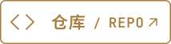

<!-- 观默 GUANMO · cinematic profile README. Generated by src/build.py — edit src/config.json, then rebuild. -->

<h3>01 / Awesome AI Motion</h3>

<a href="https://github.com/guanmo-ai/awesome-ai-motion"><picture><source media="(max-width: 767px)" srcset="assets/mobile/reel-01-motion.svg"></picture></a>

<b>发现 AI 代码驱动的动效、视频与交互作品。</b> 按创作方向浏览案例，追溯原作者与原帖，探索可找到的源码、提示词和制作资料，为下一次创作积累参考。

<b>Discover AI-coded motion, videos and interactive art.</b> Browse by creative direction, trace original creators and posts, and explore available code, prompts and production notes for your next project.

 <a href="https://github.com/guanmo-ai/awesome-ai-motion"><picture><source media="(prefers-color-scheme: dark)" srcset="assets/button-repo-dark.svg"></picture></a>

<picture><source media="(prefers-color-scheme: dark)" srcset="assets/separator-dark.svg"></picture>

<h3>02 / Design Style</h3>

<a href="https://github.com/guanmo-ai/design-style"><picture><source media="(max-width: 767px)" srcset="assets/mobile/reel-02-design.svg"></picture></a>

<b>面向设计师与 AI 的设计风格与布局参考库。</b> 用 15 秒短片、风格图、设计规则和 AI 提示词理解视觉语言，并查看源码与制作过程，把灵感带进自己的项目。

<b>Design styles and layout references for humans and AI.</b> Explore 15-second motion shorts, visual guides, design rules and AI prompts, with source code and process notes to support your own projects.

 <a href="https://github.com/guanmo-ai/design-style"><picture><source media="(prefers-color-scheme: dark)" srcset="assets/button-repo-dark.svg"></picture></a>

<picture><source media="(prefers-color-scheme: dark)" srcset="assets/separator-dark.svg"></picture>

<h3>03 / Three Atlas</h3>

<a href="https://github.com/guanmo-ai/three-atlas"><picture><source media="(max-width: 767px)" srcset="assets/mobile/reel-03-atlas.cfa20a3e1566.svg"></picture></a>

<b>在浏览器中探索交互式三维世界。</b> 从悬浮岛屿到幻想生物，汇集三维场景、模型、仿真与创意实验。旋转、靠近，在喜欢的世界停留。

<b>An atlas of interactive 3D worlds for the web.</b> Explore scenes, models, simulations and creative experiments, from floating islands to imaginary creatures. Orbit, zoom in and stay a while.

 <a href="https://github.com/guanmo-ai/three-atlas"><picture><source media="(prefers-color-scheme: dark)" srcset="assets/button-repo-dark.svg"></picture></a>

<picture><source media="(prefers-color-scheme: dark)" srcset="assets/separator-dark.svg"></picture>

<h3>04 / Awesome Agent MCP</h3>

<a href="https://github.com/guanmo-ai/awesome-agent-mcp"><picture><source media="(max-width: 767px)" srcset="assets/mobile/reel-04-agent.0f91e80c68cb.svg"></picture></a>

<b>让 Agent 接上真实世界的服务。</b> 整理国内厂商官方 MCP、Skill 与 CLI，按服务和用途检索，查看接入说明与官方来源；也支持 Agent 直接读取索引。

<b>Connect agents to real-world services.</b> Find official MCP servers, skills and CLIs from Chinese service providers, with searchable categories, setup guides and original sources. Built for people to browse and agents to read.

 <a href="https://github.com/guanmo-ai/awesome-agent-mcp"><picture><source media="(prefers-color-scheme: dark)" srcset="assets/button-repo-dark.svg"></picture></a>

<a href="https://x.com/guanmo_ai"><picture><source media="(max-width: 767px)" srcset="assets/mobile/footer.svg"></picture></a>
