<!-- 观默 GUANMO · cinematic profile README. Generated by src/build.py — edit src/config.json, then rebuild. -->

  

<picture><source media="(prefers-color-scheme: dark)" srcset="assets/divider-01-dark.svg"></picture>

<a href="https://github.com/guanmo-ai/awesome-ai-motion"><picture><source media="(max-width: 767px)" srcset="assets/mobile/reel-01-motion.svg"></picture></a>

  <b>发现 AI 代码驱动的动效、视频与交互作品。</b> 
  1,315 个作品 · 7 个创作方向 · 追溯原作者、源码与制作资料。 
  Curated AI-coded motion, video and interactive art, with original sources and creative resources.

画面来自原作者作品 · <a href="docs/SOURCES.md">查看画面来源</a>

  
  · <a href="https://github.com/guanmo-ai/awesome-ai-motion">查看源码 ↗</a>

<picture><source media="(prefers-color-scheme: dark)" srcset="assets/divider-02-dark.svg"></picture>

<a href="https://github.com/guanmo-ai/design-style"><picture><source media="(max-width: 767px)" srcset="assets/mobile/reel-02-design.svg"></picture></a>

  <b>面向设计师与 AI 的设计风格库。</b> 
  15 秒动效短片、风格图、设计规则、AI 提示词与完整源码。 
  Design references for humans and AI, with motion shorts, visual guides, prompts and source code.

  
  · <a href="https://github.com/guanmo-ai/design-style">查看源码 ↗</a>

<picture><source media="(prefers-color-scheme: dark)" srcset="assets/divider-03-dark.svg"></picture>

<a href="https://github.com/guanmo-ai/awesome-x-growth"><picture><source media="(max-width: 767px)" srcset="assets/mobile/reel-03-xgrowth.svg"></picture></a>

  <b>有出处的中文 X / Twitter 运营、涨粉与变现资料库。</b> 
  94 篇创作者经验 · 原创导读与有限摘录 · 直达作者原文。 
  94 sourced creator write-ups, with reading guides, limited excerpts and links to the original posts.

  
  · <a href="https://github.com/guanmo-ai/awesome-x-growth">查看源码 ↗</a>

 

<a href="https://x.com/guanmo_ai"><picture><source media="(max-width: 767px)" srcset="assets/mobile/footer.svg"></picture></a>
